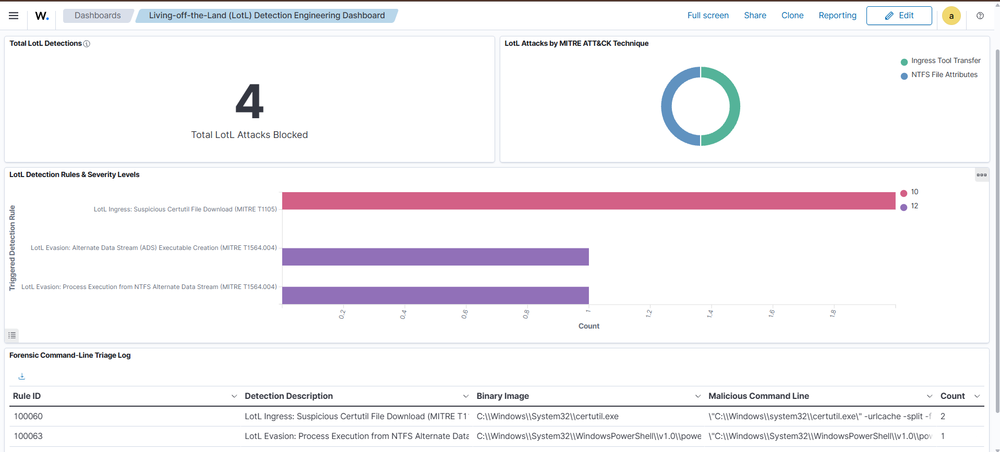
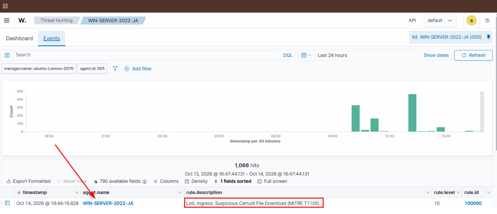
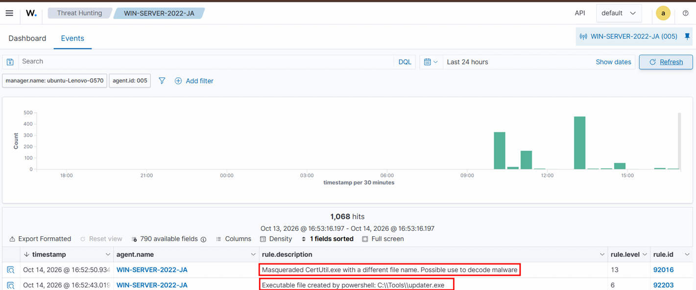
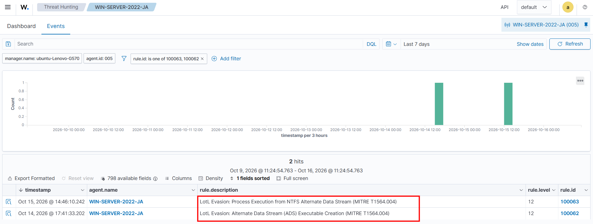

# Living-off-the-Land (LotL) Detection Engineering Lab


## 1. Executive Summary
Modern adversaries frequently bypass traditional signature-based antivirus solutions by abusing built-in, digitally signed Windows utilities—a paradigm known as **Living-off-the-Land (LotL / LOLBins)**[cite: 15]. 

This project implements a full-lifecycle **Detection Engineering Pipeline**. Using **Sysmon** modular telemetry ingested into **Wazuh**, I emulated multi-stage LotL attacks, extracted raw process and file-system telemetry, engineered high-fidelity custom detection rules in **Wazuh (PCRE2 XML)** and **Sigma (YAML)**, and validated rule resilience against binary masquerading techniques[cite: 15, 17, 20, 21, 28].



---

## 2. Lab Architecture & Methodology

### Infrastructure Stack
* **SIEM Server / Manager:** Wazuh Manager & OpenSearch Indexer (`v4.14.8`) on Ubuntu 24.04 LTS (`192.168.68.157`)[cite: 11, 13]
* **Target Endpoint:** Windows Server 2022 Standard (`WIN-SERVER-2022-JA` / `192.168.68.201`)[cite: 13]
* **Endpoint Sensor:** Microsoft Sysinternals Sysmon (`v15.22`) configured with the **SwiftOnSecurity** modular schema (`sysmonconfig-export.xml`)[cite: 5, 6]
* **Telemetry Channels Monitored:**
  * `Sysmon Event ID 1`: Process Creation (Full `CommandLine`, `ParentImage`, `Hashes`, `OriginalFileName`)[cite: 21, 23]
  * `Sysmon Event ID 11`: FileCreate (Target file creation & NTFS stream modifications)[cite: 23, 24]
  * `Wazuh Syscheck`: Real-time File Integrity Monitoring (FIM)[cite: 14]

### Detection Engineering Lifecycle
1. **Threat Modeling & Technique Selection:** Scoping dual-use Windows utilities abused for Ingress Tool Transfer (`T1105`) and Defense Evasion (`T1564.004`)[cite: 15, 21].
2. **Adversary Emulation & Telemetry Capture:** Executing controlled attack simulations and harvesting raw JSON alerts from `/var/ossec/logs/alerts/alerts.json`[cite: 15, 23, 25].
3. **Detection Rule Engineering:** Elevating low-priority informational events (Level 3) into actionable high-severity incidents (Levels 10–12) using PCRE2 regular expressions[cite: 17, 18, 23, 24].
4. **Evasion Testing:** Attempting detection bypasses via binary renaming (`certutil.exe` -> `updater.exe`) to verify metadata-level inspection[cite: 20, 21].
5. **Sigma Standardization:** Translating validated logic into vendor-agnostic Sigma rules[cite: 15, 28].

---

## 3. Scenario 1: Ingress Tool Transfer via `certutil.exe` & `bitsadmin.exe` (MITRE T1105)

### Threat Context
`certutil.exe` is a legitimate Windows tool meant for managing certificates[cite: 15, 16]. However, attackers abuse its `-urlcache` and `-split` parameters to turn it into a stealthy HTTP download cradle[cite: 15, 16, 17]. Similarly, `bitsadmin.exe` is abused to stage malicious payloads via background transfer jobs (`T1197`)[cite: 15, 16].

### Adversary Emulation
Executed in an elevated PowerShell session on `WIN-SERVER-2022-JA`:
```powershell
# Technique 1A: Certutil URL Cache Download
certutil.exe -urlcache -split -f "[https://raw.githubusercontent.com/SigmaHQ/sigma/master/README.md](https://raw.githubusercontent.com/SigmaHQ/sigma/master/README.md)" "C:\Tools\certutil_stage1.txt"

# Technique 1B: Bitsadmin Background Transfer Job
bitsadmin.exe /transfer lotl_job /download /priority normal "[https://raw.githubusercontent.com/SigmaHQ/sigma/master/LICENSE.Detection.Rules.md](https://raw.githubusercontent.com/SigmaHQ/sigma/master/LICENSE.Detection.Rules.md)" "C:\Tools\bits_stage2.txt"
```

### Raw Telemetry Extracted (`alerts.json`)
By default, Wazuh classifies Sysmon Event ID 1 as a generic Level 3 informational event (`Rule 100002`)[cite: 18, 23]:
```json
{
  "agent": { "id": "005", "name": "WIN-SERVER-2022-JA", "ip": "192.168.68.201" },
  "data": {
    "win": {
      "system": { "eventID": "1", "channel": "Microsoft-Windows-Sysmon/Operational" },
      "eventdata": {
        "image": "C:\\\\Windows\\\\System32\\\\certutil.exe",
        "originalFileName": "CertUtil.exe",
        "commandLine": "\"C:\\\\Windows\\\\system32\\\\certutil.exe\" -urlcache -split -f [https://raw.githubusercontent.com/SigmaHQ/sigma/master/README.md](https://raw.githubusercontent.com/SigmaHQ/sigma/master/README.md) C:\\\\Tools\\\\certutil_stage1.txt",
        "parentImage": "C:\\\\Windows\\\\System32\\\\WindowsPowerShell\\\\v1.0\\\\powershell.exe"
      }
    }
  }
}
```

### Engineered Detection Rule (Rule ID: `100060`)
```xml
<rule id="100060" level="10">
  <if_sid>100002</if_sid>
  <field name="win.eventdata.image" type="pcre2">(?i)\\certutil\.exe$</field>
  <field name="win.eventdata.commandLine" type="pcre2">(?i)(-urlcache|-split|\/urlcache|\/split)</field>
  <description>LotL Ingress: Suspicious Certutil File Download (MITRE T1105)</description>
  <mitre>
    <id>T1105</id>
  </mitre>
</rule>
```



### Evasion Testing: Binary Masquerading (`T1036.003`)
To test whether an attacker could bypass path-based detection by copying and renaming the binary[cite: 20]:
```powershell
Copy-Item "$env:SystemRoot\System32\certutil.exe" "C:\Tools\updater.exe"
C:\Tools\updater.exe -urlcache -split -f "[https://raw.githubusercontent.com/SigmaHQ/sigma/master/README.md](https://raw.githubusercontent.com/SigmaHQ/sigma/master/README.md)" "C:\Tools\stage2_evasion.txt"
```
**Result:** The evasion was defeated. Because Sysmon parses PE header metadata (`OriginalFileName: CertUtil.exe`), Wazuh triggered **Rule 92016 (Level 13)**: *"Masqueraded CertUtil.exe with a different file name. Possible use to decode malware."*[cite: 1, 21]



---

## 4. Scenario 2: Defense Evasion via NTFS Alternate Data Streams (MITRE T1564.004)

### Threat Context
To hide downloaded scripts from standard directory inspections (`dir` / `Get-ChildItem`), adversaries inject malicious code into **NTFS Alternate Data Streams (ADS)** attached behind benign files, and subsequently execute them in-memory via PowerShell[cite: 21, 22, 26].

### Adversary Emulation
```powershell
# 1. Create a benign decoy file
Set-Content -Path "C:\Tools\readme.txt" -Value "This is a normal log file."

# 2. Inject a hidden PowerShell payload into an Alternate Data Stream
Set-Content -Path "C:\Tools\readme.txt" -Stream "hidden_stage2.ps1" -Value "Write-Host 'Testing Rule 100062'"

# 3. Execute the hidden stream directly in memory
powershell.exe -ExecutionPolicy Bypass -Command "Invoke-Expression (Get-Content -Path C:\Tools\readme.txt -Stream hidden_stage2.ps1)"
```

### Engineered Detection Rules (Rule IDs: `100062` & `100063`)
We established defense-in-depth across two distinct Sysmon telemetry channels:
1. **Stream Creation (`Rule 100062` - Level 12):** Monitors Sysmon Event ID 11 (`FileCreate`) for the colon (`:`) stream operator paired with executable extensions in `targetFilename`[cite: 23, 24, 25].
2. **Stream Execution (`Rule 100063` - Level 12):** Monitors Sysmon Event ID 1 (`ProcessCreate`) for command lines invoking `-stream` or colon-delimited script paths[cite: 26, 27, 28].

```xml
<!-- Rule 100062: Detect ADS script/executable creation (T1564.004) -->
<rule id="100062" level="12">
  <if_group>sysmon_eid11_detections</if_group>
  <field name="win.eventdata.targetFilename" type="pcre2">(?i)\:[a-zA-Z0-9_\-\.]+\.(ps1|exe|vbs|bat|cmd|dll)$</field>
  <description>LotL Evasion: Alternate Data Stream (ADS) Executable Creation (MITRE T1564.004)</description>
  <mitre>
    <id>T1564.004</id>
  </mitre>
</rule>

<!-- Rule 100063: Detect Execution from NTFS Alternate Data Stream (T1564.004) -->
<rule id="100063" level="12">
  <if_group>sysmon_eid1_detections</if_group>
  <field name="win.eventdata.commandLine" type="pcre2">(?i)(-stream\s+|:[a-zA-Z0-9_\-\.]+\.(ps1|exe|vbs|bat|cmd|dll))</field>
  <description>LotL Evasion: Process Execution from NTFS Alternate Data Stream (MITRE T1564.004)</description>
  <mitre>
    <id>T1564.004</id>
  </mitre>
</rule>
```



---

## 5. Repository Structure
```text
Living-off-the-Land-Detection-Lab/
├── assets/
│   ├── lotl-soc-dashboard.png
│   ├── certutil-t1105-alert.png
│   ├── masqueraded-certutil-evasion.png
│   └── ads-t1564-execution.png
├── rules/
│   ├── sigma/
│   │   └── sysmon_ads_execution.yml
│   └── wazuh/
│       └── local_rules.xml
├── LICENSE
└── README.md
```

## 👤 Author
**Jerick Andrew S**  
